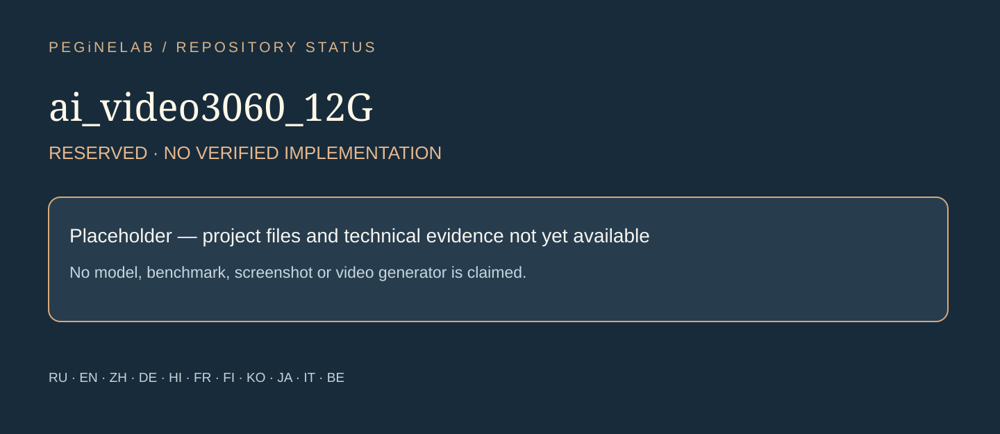

# ai_video3060_12G · Repository showcase

**This repository has no verified application implementation yet.** Future work is intentionally not presented as a shipped video generator.

### Русский · ru
Пустой публичный репозиторий. **ai_video3060_12G:** Repository created → No source files → Not yet documented → No verified release.

### English · en
Empty public repository. **ai_video3060_12G:** Repository created → No source files → Not yet documented → No verified release.

### 简体中文 · zh
空的公开仓库. **ai_video3060_12G:** Repository created → No source files → Not yet documented → No verified release.

### Deutsch · de
Leeres öffentliches Repository. **ai_video3060_12G:** Repository created → No source files → Not yet documented → No verified release.

### हिन्दी · hi
खाली सार्वजनिक रिपॉज़िटरी. **ai_video3060_12G:** Repository created → No source files → Not yet documented → No verified release.

### Français · fr
Dépôt public vide. **ai_video3060_12G:** Repository created → No source files → Not yet documented → No verified release.

### Suomi · fi
Tyhjä julkinen repositorio. **ai_video3060_12G:** Repository created → No source files → Not yet documented → No verified release.

### 한국어 · ko
비어 있는 공개 저장소. **ai_video3060_12G:** Repository created → No source files → Not yet documented → No verified release.

### 日本語 · ja
空の公開リポジトリ. **ai_video3060_12G:** Repository created → No source files → Not yet documented → No verified release.

### Italiano · it
Repository pubblico vuoto. **ai_video3060_12G:** Repository created → No source files → Not yet documented → No verified release.

### Беларуская · be
Пусты публічны рэпазіторый. **ai_video3060_12G:** Repository created → No source files → Not yet documented → No verified release.

## Contacts

[Telegram @Feudorlab1](https://t.me/Feudorlab1) · [+7 926 041 1145](tel:+79260411145) · [feudor.lab@yandex.ru](mailto:feudor.lab@yandex.ru) · [obzorniky@gmail.com](mailto:obzorniky@gmail.com) · [peginelab.ru](https://peginelab.ru/).
